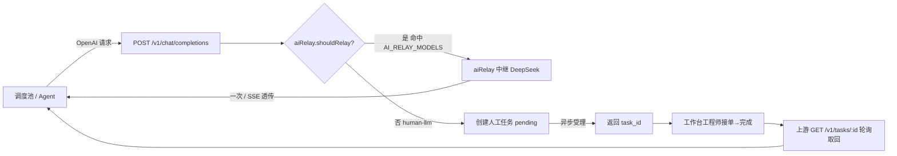
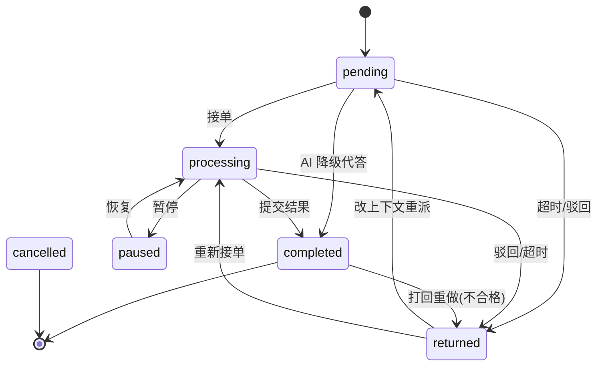

# P390 · 技术架构

> 人工代理网关（Human-as-LLM）。Node.js + Express + Socket.IO + PostgreSQL。

## 一、技术栈

| 层 | 选型 |
|---|---|
| 后端 | Node.js + Express 4 + Socket.IO |
| 数据库 | PostgreSQL 5433（库 `p390`，16 张表） |
| 认证 | JWT（jsonwebtoken + bcryptjs），admin / engineer 双角色 |
| 前端 | Vanilla HTML/JS/CSS（IIFE 模块，SVG 图标，4 主题，响应式，中英 i18n） |
| AI 中继 | 原生 `fetch`（OpenAI 兼容，一次 + stream 透传） |
| 通知 | notifier（邮件 nodemailer + Webhook，均可配置，未配置降级） |
| 安全 | 基础头 + CORS + 限流（按项目约定禁 CSP/HSTS） |

## 二、目录结构

```
server.js            # 入口：Socket.IO 认证 + 安全头 + /metrics + 路由 + 启动扫描器
├── middleware/       # auth(JWT+角色+租户key) / security(头+CORS+限流) / taskAccess(租户+归属校验)
├── db/               # index(连接+建表+迁移+pg_trgm) / adapters/{pg,mysql,sqlite} / dialect
├── routes/           # v1(OpenAI) approvals projects tasks workbench auth users logs
│                     #   rules(分级配置) tenants(租户) gateway(多工具安装) audit prd index
│                     #   templates dispatch alerts billing knowledge reviews backup metrics
├── services/         # 业务核心
│   ├── stateMachine.js      # 状态机单例（任务/审批转换表 + 校验）
│   ├── waiters.js           # 等待者单例工厂（审批挂起等待/唤醒/超时）
│   ├── queueService.js      # 状态机流转 + 分级定级 + AI 降级 + 质量校验 + 超时扫描 + 定向推送
│   ├── categoryEngine.js    # 分级策略引擎（规则白名单锁死 > 上游显式 > 默认 general）
│   ├── aiShift.js / aiRelay.js  # 智能漂移 / DeepSeek 中继
│   ├── approvalService.js   # 审批状态机 + 挂起等待 + 24h 超时提醒
│   ├── openaiEncoder.js     # OpenAI 响应 / SSE chunk 封装
│   ├── taskView.js          # 上游视图（回查/回调共用，含审核可见性）
│   ├── conversationService.js  # 多轮追问（会话解析/继承/时间线）
│   ├── templateService.js   # 工单模板（合并语义：模板给默认值，上游优先）
│   ├── dispatchService.js   # 智能派单（技能 0.5 + 负载 0.3 + 通过率 0.2）
│   ├── alertService.js      # 告警升级序列（L1~L5，原子去重）
│   ├── billingService.js    # 计费（分级×优先级费率，幂等结算）
│   ├── projectService.js / projectMemberService.js  # 项目 CRUD / 项目成员权限
│   ├── knowledgeService.js  # 知识库（三级作用域可见性）
│   ├── reviewService.js     # 答复审核（四维评分 + 抽检）
│   ├── feedbackService.js   # 效果回流（未解决自动重开追问）
│   ├── draftService.js      # AI 起草（仅 general，含留痕）
│   ├── reportService.js     # 合规报告（数据采集 + HTML 渲染）
│   ├── metricsService.js    # Prometheus 指标（prom-client，可降级）
│   ├── notifier.js / mailer.js / callback.js / websocket.js  # 通知与推送
│   └── i18n.js / csv.js / sseStream.js / taskEvents.js / toolCalls.js  # 辅助
├── public/           # login/workbench/mobile/offline.html + landing/
│                     #   css/(style|mobile) + js/(utils|api|ws|ui|app|i18n|pwa|templates|billing|dispatch|alerts|knowledge|review|mobile)
├── scripts/          # seed / smoke-test / check-secret / demo-client
│                     #   backup.js / restore.js / drill-restore.js / gen-icons.js / ui-check.js
├── tests/            # unit(18) + integration(19)，node --test
├── data/             # 运行时文件（backups / gateway 配置 / ui-shots，gitignore）
└── docs/             # API / ARCHITECTURE / DEPLOY / ROADMAP / GOVERNANCE 等
```

## 三、核心机制

### 1. 请求生命周期（模型名路由 → 等待者 → 结果回传）



> 任务为小时级，`/v1/chat/completions` **异步受理**（立即返回 `task_id`，不挂起），上游凭 `GET /v1/tasks/:id` 轮询取回人工产出。审批（分钟级）才走挂起等待，见「等待者」。

### 2. 任务状态机（单例 stateMachine）



### 3. 交互模式：任务异步回查、审批挂起等待

- **任务（`/v1/chat/completions`）**：人工为小时级，异步受理——创建任务后立即返回 `task_id`，上游 `GET /v1/tasks/:id` 轮询取结果，不阻塞请求（`routes/v1.js`）。SSE 请求也只回受理信息即结束。
- **审批（`/v1/approvals`）**：人类响应为分钟级，`approvalService.waitForApproval(id, timeout)` 挂起等待，批准/驳回后 `waiters.resolve` 唤醒返回。
- 超时 → `onTimeout()` 返回兜底（`timedOut: true`）。
- 审批使用 `createWaiterStore()` 实例（id 为自增数字）；任务不使用等待者。

### 4. 双扫描器

| 扫描器 | 间隔 | 逻辑 |
|---|---|---|
| `queueService.startTimeoutScanner()` | 30s | 待接单超时 → AI 降级代答（失败回落 returned）；处理中超时 → returned |
| `approvalService.startApprovalScanner()` | 60s | 待审批超 24h → 广播 `approval:overdue` 提醒 |

### 5. 模型名路由

`routes/v1.js`：解析请求 → `aiRelay.shouldRelay(model)`：
- 命中 `AI_RELAY_MODELS`（如 `deepseek-v4-flash`）→ 中继转发真实 LLM（一次 `chat()` / SSE `relayStream()` 透传）；
- 否则走人工：`createTaskFromRequest`（分级定级 + 创建 pending）→ **异步受理返回 `task_id`** → 上游轮询 `GET /v1/tasks/:id` 取回人工产出。

### 6. 质量闭环

- **提交校验**：`completeTask` 先过 `qualityCheck`（空 / 过短<20 字 / 占位词 → 拦截 400）。
- **打回重做**：`completed → returned`（`reopenTask`），清空结果重新派发。
- **审计留痕**：`task_logs` 记录每一步（create/claim/complete/reject/reopen/timeout…）。

### 7. 实时推送

Socket.IO 房间模型（`user:*` / `admin` / `system`），事件：
- `task:new` / `task:update` / `task:timeout`
- `approval:new` / `approval:update` / `approval:overdue`

前端收到 → toast + 自动刷新（`public/js/ws.js` → `app.js`）。

## 四、数据模型（PostgreSQL / 库 p390）

| 表 | 关键字段 | 用途 |
|---|---|---|
| `users` | username, email, password, role(admin/engineer), name, is_active, skills, tenant_id | 账户 |
| `tasks` | upstream_request_id, model, stream, priority, category, rule_id, project_code, payload, status, assignee_id, result_text, reject_reason, timeout_at, conversation_id, turn_index, template_id, escalation_level, remind_count | 人工任务 |
| `task_logs` | task_id, action, old_value(JSONB), new_value(JSONB), actor_name, remark, prev_hash, hash | 状态审计（哈希链防篡改） |
| `request_logs` | task_id, tenant_id, direction(in/out), payload(JSONB), model | 请求/输出日志 |
| `approvals` | approval_no, type(resource/project), resource, amount, purpose, status, provider_name, provided, reject_reason, decided_at, remind_count | 审批单 |
| `projects` | code(unique), name, description, status, created_by, tenant_id | 项目 |
| `task_rules` | name, category, match_field, keywords, priority, enabled, tenant_id | 分级策略规则（白名单锁死） |
| `tenants` | code, name, upstream_key | 租户（上游 API key 路由租户） |
| `task_templates` | name, category, priority, skills, system_prompt, payload_template(JSONB), enabled, use_count | 工单模板 |
| `alerts` | task_id, approval_id, level(1-5), kind, status, title, detail, tenant_id | 告警（SLA 升级序列） |
| `billing_rates` | tenant_id, category, priority, unit_price_cents, min_charge_cents | 计费费率（全局 + 租户） |
| `billing_ledger` | task_id(unique), billable_minutes, amount_cents, source(human/ai_relay/ai_shift), period | 计费流水（幂等） |
| `project_members` | project_code, user_id(unique 组合), role(owner/member/viewer), tenant_id | 项目成员（项目级权限） |
| `knowledge_entries` | title, category, scope(project/tenant/global), project_code, problem, solution, tags, use_count | 知识库（答复复用） |
| `task_reviews` | task_id(unique), status(draft/delivered/needs_revision/spot_checked), reviewer_id, 四维评分, score_total | 答复审核 |
| `task_feedback` | task_id(unique), resolved, rating, comment | 上游效果反馈（数据飞轮） |

**关系**：
- `tasks.project_code` → `projects.code`（列表 join 出 `project_name`）；`tasks.rule_id` → `task_rules.id`（分级理由留痕）；`tasks.template_id` → `task_templates.id`
- `tasks.conversation_id` 自关联：同一会话按 `turn_index` 排序成时间线，`parent_task_id` 指向上一轮
- `users/tasks/approvals/projects/task_rules/alert/billing/knowledge.tenant_id` → `tenants.id`
- `project_members(user_id, project_code)` → 项目级权限（知识库 `scope=project` 的可见性依赖此表）
- `task_reviews/task_feedback/billing_ledger/alerts.task_id` → `tasks.id`，**均带外键**（删任务前必须先删这些子表）
- `approvals.type=project` 批准后自动写入 `projects`，并把创建者设为 `owner`

> 共 16 张表。新增带外键的表后，所有集成测试的清理顺序必须补齐，否则删除 `tasks` 会因外键失败导致测试挂起。

## 五、人机协作闭环（2026-10 交付）

线上真实用法：WorkBuddy 用户把超出能力的事委托到平台 → 专业人员分析 → 给出经审计的答复 → 大模型把答复融进下一步。五个环节：

| 环节 | 服务 | 关键约束 |
|---|---|---|
| 接单 | `mobile.html` + `mobile.js` + `draftService.js` | AI 起草仅 general 类；`confidential`/`ops` 硬性拒绝（上下文不出网关） |
| 追问 | `conversationService.js` | 追问继承首轮分级，受保护类不因内容变无害而降级 |
| 复用 | `projectMemberService.js` + `knowledgeService.js` | 三级作用域；`confidential` 条目只能 project 或作者私有 |
| 质量 | `reviewService.js` | general 免审、ops/confidential 单人审核、confidential 加 admin 抽检 |
| 回流 | `feedbackService.js` | `resolved=false` 且 7 天内 → 自动重开同会话追问 |


## 六、关键设计点

1. **上游零改动**：调度池只加一条模型路由（`human-llm` / `deepseek-v4-flash`）即接入，无需区分人工/AI。
2. **双通道更新兼容**：`transition()` 的 update 值支持 `{__expr:'NOW()…'}`（拼 SQL 表达式）与参数绑定两种，避免注入且能写 `NOW()`/`interval`。
3. **数据库适配器**：`db.exec()→[{columns,values}]`、`db.run()→{changes,lastId}`，PG 自动 `?→$n` 与 `RETURNING id`；`CREATE TABLE IF NOT EXISTS` + `ALTER TABLE ADD COLUMN IF NOT EXISTS` 做兼容迁移。
4. **humanllm 子代理**（`.claude/agents/humanllm.md`）：任务包模板（【任务】【交人工原因】【项目与代码库】【接单流程】【环境约定】【要求】）+ 资源审批预检（第 0 步）。
